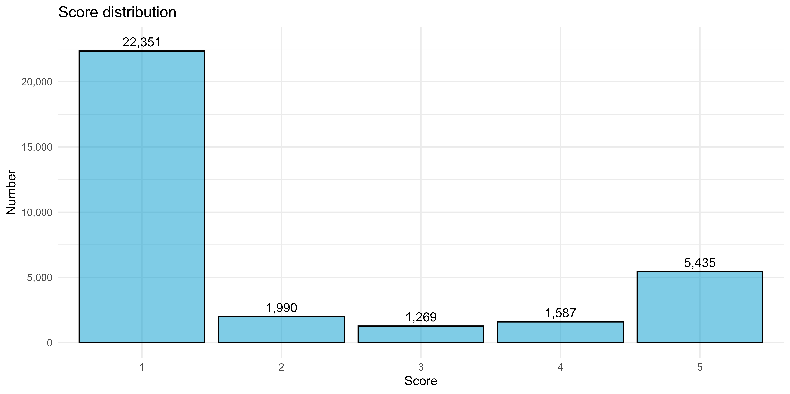
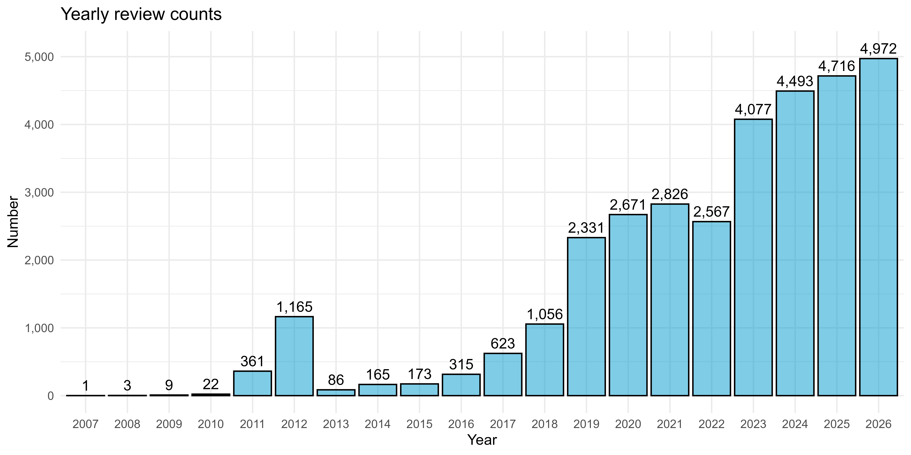
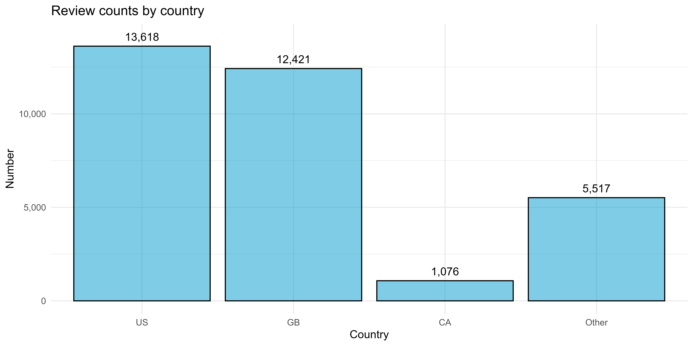

<!-- README.md is generated from README.Rmd. Please edit that file -->

```{r, include = FALSE}
knitr::opts_chunk$set(
  collapse = TRUE,
  comment = "#>"
)
```

# dataset-amazon_trustpilot_reviews

This repository contains a dataset file `amazon_com_reviews_trustpilot_20261026_anon.feather` with all available English Trustpilot reviews for Amazon.com on October 26, 2026. The first review is from August 27, 2007, while the last one is from October 26, 2026. This amounts to 32,632 reviews.

All rights to the data belong to Trustpilot. The data should not be used for commercial purposes.

## Variables

The following eight variables are available:

1. `User_ID`: an `int` column, giving the unique user ID; the same ID means that reviews were written by the same user.

2. `Review_Date`: a `chr` variable giving the exact publishing time point of the review in `%Y-%m-%d %H:%H:%S` format (datetime to be interpreted as UTC).

3. `Experience_Date`: a `chr` column giving the date in `%Y-%m-%d` format, on which the experience the review is written about was experienced; this date is entered manually by the review author.

4. `User_Name`: a `chr` column giving the user name of the review author; a user name is not unique; note that user names have been anonymized in comparison to the original data.

5. `User_Country`: a `chr` column giving the country of the review author in alpha-2 ISO 3166 format.

6. `Review_Score`: an `int` column giving the score of the review; is always an integer from 1 through 5.

7. `Review_Title`: a `chr` column giving the title of the review.

8. `Review_Sentences`: a column with lists; each lists contains the individual sentences as `chr` entries of a review in correct order.


## Distribution information

The distribution of scores in the entire dataset is as depicted in Figure \@ref(fig:scores).

```{r scores, fig.cap="Distribution of English Amazon.com Trustpilot scores between August 27, 2007, and October 26, 2026.", echo = FALSE, out.width = "80%", out.height = "80%", fig.align='center'}

```

```{r, echo = FALSE}
cat(paste0(
  "Score key numbers:\n",
  "******************\n",
  "Number of obs.     32632\n",
  "Mean                1.95\n",
  "Standard deviation  1.55\n",
  "Minimum             1.00\n",
  "1st Quartile        1.00\n",
  "Median              1.00\n",
  "3rd Quartile        3.00\n",
  "Maximum             5.00\n"
))
```


```{r year-rev-number, fig.cap="Review counts by year.", echo = FALSE, out.width = "80%", out.height = "80%", fig.align='center'}

```

```{r country-rev-number, fig.cap="Review counts by country.", echo = FALSE, out.width = "80%", out.height = "80%", fig.align='center'}

```
